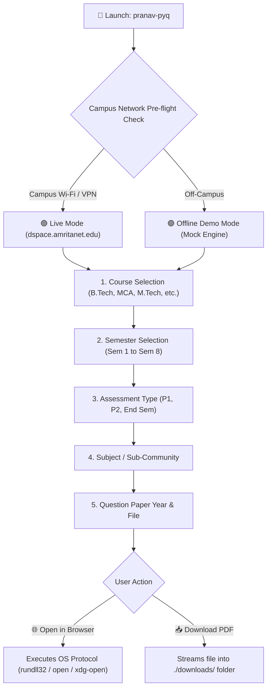

<div align="center">

  

  # ⚡ PRANAV PYQ FETCHER AMRITA ⚡
  
  <p align="center">
    <b>A fast, beautiful, and interactive Terminal Interface (TUI) to browse, search, and download Previous Year Question Papers (PYQs) from Amrita University's digital repository.</b>
  </p>

  <!-- Badges Shelf -->
  <p align="center">
    <a href="https://github.com/pkpranav-projects/PRANAV-PYQ-FETCHER-AMRITA/releases/latest"></a>
    <a href="https://github.com/pkpranav-projects/PRANAV-PYQ-FETCHER-AMRITA/releases"></a>
    <a href="https://pkpranav-projects.github.io/PRANAV-PYQ-FETCHER-AMRITA/"></a>
    
    
    
    <a href="LICENSE"></a>
  </p>

  <p align="center">
    <a href="https://pkpranav-projects.github.io/PRANAV-PYQ-FETCHER-AMRITA/"><b>🌐 Documentation Website</b></a> •
    <a href="#-downloads--releases"><b>Downloads</b></a> •
    <a href="#-key-features"><b>Key Features</b></a> •
    <a href="#-terminal-walkthrough"><b>Terminal Walkthrough</b></a> •
    <a href="#-campus-network--offline-demo-mode"><b>Network Modes</b></a> •
    <a href="#%EF%B8%8F-keyboard-shortcuts"><b>Shortcuts</b></a> •
    <a href="#%EF%B8%8F-architecture--how-it-works"><b>Architecture</b></a>
  </p>

</div>

---

## 📦 Downloads & Releases

Pre-compiled, ready-to-run releases are available for Windows, Linux, and macOS. **No Go installation required!**

| Platform | Architecture | Download Package | Quick Launch |
|:---|:---:|:---|:---|
| 🪟 **Windows** | x86_64 / amd64 | [**`pranav-pyq-v2.0.0-windows-amd64.zip`**](https://github.com/pkpranav-projects/PRANAV-PYQ-FETCHER-AMRITA/releases/download/v2.0.0/pranav-pyq-v2.0.0-windows-amd64.zip) | Extract and double-click `run.bat` |
| 🐧 **Linux** | x86_64 / amd64 | [**`pranav-pyq-v2.0.0-linux-amd64.tar.gz`**](https://github.com/pkpranav-projects/PRANAV-PYQ-FETCHER-AMRITA/releases/download/v2.0.0/pranav-pyq-v2.0.0-linux-amd64.tar.gz) | `tar -xzf ...` & `./pranav-pyq` |
| 🍎 **macOS** | Apple Silicon (M1/M2/M3/M4) | [**`pranav-pyq-v2.0.0-darwin-arm64.tar.gz`**](https://github.com/pkpranav-projects/PRANAV-PYQ-FETCHER-AMRITA/releases/download/v2.0.0/pranav-pyq-v2.0.0-darwin-arm64.tar.gz) | `tar -xzf ...` & `./pranav-pyq` |
| 🍎 **macOS** | Intel x86_64 | [**`pranav-pyq-v2.0.0-darwin-amd64.tar.gz`**](https://github.com/pkpranav-projects/PRANAV-PYQ-FETCHER-AMRITA/releases/download/v2.0.0/pranav-pyq-v2.0.0-darwin-amd64.tar.gz) | `tar -xzf ...` & `./pranav-pyq` |

👉 View all releases and notes on the [**GitHub Releases Page**](https://github.com/pkpranav-projects/PRANAV-PYQ-FETCHER-AMRITA/releases).

---

## 📖 Overview

Amrita Vishwa Vidyapeetham stores its official Previous Year Question Papers (PYQs) within its internal **DSpace Digital Repository** (`dspace.amritanet.edu:8080`). Browsing this archive through a web browser can be tedious and slow.

**PRANAV PYQ FETCHER AMRITA** transforms the entire retrieval process into an intuitive, keyboard-driven terminal application. With real-time network checks, fuzzy search filtering, offline exploration, and one-click PDF browser viewing or local downloading, finding exam papers is instantaneous.

---

## ✨ Key Features

- 🛡️ **Direct Course & Branch Select**: Instantly pick from top branches including **Cyber Security (`CYS`)**, **Computer Science (`CSE`)**, **Electronics (`ECE`)**, **Artificial Intelligence (`AIE`)**, **Electrical (`EEE`)**, **Mechanical (`MECH`)**, **`MCA`**, and **`M.Tech`**, or browse the full raw DSpace directory.
- 📚 **Subject-First Workflow**: Browse all subjects mapped to your branch (e.g., *19CYS202 - Cryptography and Network Security*) with real-time fuzzy search (`/`) before viewing papers.
- 📥 **Bulk "Download ALL Papers"**: Save every question paper for your chosen subject in a single action with real-time progress indicators into organized subdirectories.
- ⚡ **Automatic Campus Pre-Flight Check**: Pings `dspace.amritanet.edu:8080` on launch to verify campus network connectivity.
- 🚀 **Offline Demo Mode**: Stuck at home without campus Wi-Fi or VPN? Launch Demo Mode to explore the full curriculum, test filters, and preview the workflow with simulated papers.
- 🔍 **Instant Fuzzy Search (`/`)**: Simply tap `/` in any menu to type and filter subjects, branches, or papers on the fly.
- 🌐 **Seamless In-Browser Viewing**: Opens selected PDFs directly in your default web browser (Edge, Chrome, Brave, Firefox) using native OS handlers.
- 📁 **Organized Local Downloads**: Automatically structures downloads into clean folders like `downloads/CYS/19CYS202/`.
- ⬅️ **Smart Stack Navigation & Breadcrumbs**: Displays your exact location (e.g. `CYS → 19CYS202 Cryptography and Network Security`) and lets you step back effortlessly without restarting.
- 🎨 **Modern Terminal User Interface**: Styled with Charm's `huh` and `lipgloss` with custom ASCII banners, spinners, and vibrant color-coded states.

---

## 🖥️ Terminal Walkthrough

### 1. Launching & Course / Branch Selection
When you run `pranav-pyq`, the app performs the campus network check and lets you pick your engineering branch directly:

```text
$ pranav-pyq

  ____  ____     _    _   _    _    __     __
 |  _ \|  _ \   / \  | \ | |  / \   \ \   / /
 | |_) | |_) | / _ \ |  \| | / _ \   \ \ / / 
 |  __/|  _ < / ___ \| |\  |/ ___ \   \ V /  
 |_|   |_| \_/_/   \_\_| \_/_/   \_\   \_/   
  ____  __   ______   _____ _____ _____ ____ _   _ _____ ____  
 |  _ \ \ \ / / __ \ |  ___| ____|_   _/ ___| | | | ____|  _ \ 
 | |_) | \ V / |  | || |_  |  _|   | || |   | |_| |  _| | |_) |
 |  __/   | || |__| ||  _| | |___  | || |___|  _  | |___|  _ < 
 |_|      |_| \___\_\|_|   |_____| |_| \____|_| |_|_____|_| \_\
               === AMRITA UNIVERSITY EDITION ===

Select Course / Branch (Press '/' to search)
> CYS    │ Cyber Security
  CSE    │ Computer Science & Engineering
  ECE    │ Electronics & Communication
  AIE    │ Artificial Intelligence
  EEE    │ Electrical & Electronics
  MECH   │ Mechanical Engineering
  MCA    │ Master of Computer Applications
  MTECH  │ M.Tech Computer Science
  📂     │ Browse Full DSpace Directory (Semester by Semester)
  ❌     │ Quit
```

---

### 2. Choosing Your Subject
Select your subject from the curated branch catalog (or tap `/` to filter):

```text
Selection(s):
CYS (Cyber Security)

Select Subject for CYS (Press '/' to filter)
  19CYS201   │ Foundations of Cyber Security
> 19CYS202   │ Cryptography and Network Security
  19CYS203   │ Operating Systems and System Security
  19CYS204   │ Data Structures and Algorithms
  19CYS205   │ Computer Networks and Protocols
  19CYS301   │ Secure Coding and Software Security
  19CYS302   │ Digital Forensics and Incident Response
  🔙 Back to Courses
  ❌ Quit
```

---

### 3. Displaying Papers & "Download ALL Papers"
View all question papers for the chosen subject and download them all in bulk:

```text
Selection(s):
CYS → 19CYS202 Cryptography and Network Security

Papers for 19CYS202: Cryptography and Network Security
> 📥 Download ALL Papers (8 available)
  2023 - End Semester Examination (Solved)
  2023 - Periodical Examination 2 (P2)
  2023 - Periodical Examination 1 (P1)
  2022 - End Semester Examination
  2022 - Periodical Examination 2 (P2)
  2022 - Periodical Examination 1 (P1)
  2021 - End Semester Examination
  2020 - End Semester Examination
  🔙 Back to Subjects
  🏠 Main Menu
  ❌ Quit
```

Selecting **📥 Download ALL Papers** starts an automated bulk download with real-time file-by-file progress:

```text
📥 Bulk Downloading 8 question paper(s) into ./downloads/CYS/19CYS202...

  [1/8] Downloading 2023 - End Semester Examination (Solved)... ✓ Saved
  [2/8] Downloading 2023 - Periodical Examination 2 (P2)... ✓ Saved
  [3/8] Downloading 2023 - Periodical Examination 1 (P1)... ✓ Saved
  [4/8] Downloading 2022 - End Semester Examination... ✓ Saved
  [5/8] Downloading 2022 - Periodical Examination 2 (P2)... ✓ Saved
  [6/8] Downloading 2022 - Periodical Examination 1 (P1)... ✓ Saved
  [7/8] Downloading 2021 - End Semester Examination... ✓ Saved
  [8/8] Downloading 2020 - End Semester Examination... ✓ Saved

✓ Bulk Download Complete! All 8 papers saved in ./downloads/CYS/19CYS202
```

---

## 📶 Campus Network & Offline Demo Mode

Because `dspace.amritanet.edu` is hosted on Amrita's private internal intranet, live question paper fetching requires connectivity to the university network:

| Environment | Connection Mode | Status | Capabilities |
|:---|:---|:---:|:---|
| **At University** | Connected to **Amrita Wi-Fi** | 🟢 Live | Direct live fetching, streaming & downloading from university archives. |
| **At Home with VPN** | Connected to **Amrita GlobalProtect VPN** | 🟢 Live | Full access to real-time papers from anywhere in the world. |
| **At Home / Mobile Data** | Off-campus network | 🟣 Demo Mode | **Offline Demo Mode** enabled! Browse sample courses, test filters, and test all app features. |

---

## 🚀 Running from Source (Developers)

```bash
# Clone the repository
git clone https://github.com/pkpranav-projects/PRANAV-PYQ-FETCHER-AMRITA.git

# Enter the directory
cd PRANAV-PYQ-FETCHER-AMRITA

# Run directly
go run main.go

# Or build the binary
go build -ldflags="-s -w" -o pranav-pyq.exe main.go
```

---

## ⌨️ Keyboard Shortcuts

| Key | Action |
|:---:|:---|
| **`↑` / `k`** | Move cursor up |
| **`↓` / `j`** | Move cursor down |
| **`Enter`** | Confirm selection |
| **`/`** | Activate instant fuzzy search filter |
| **`Back`** | Return to previous menu level |
| **`Quit`** | Exit cleanly with animated spinner |

---

## 🏗️ Architecture & How It Works



---

## 🧰 Tech Stack

- **Core Language:** [Go (Golang)](https://go.dev/)
- **CLI Framework:** [spf13/cobra](https://github.com/spf13/cobra)
- **TUI Controls & Spinners:** [charmbracelet/huh](https://github.com/charmbracelet/huh)
- **Terminal Styling & Themes:** [charmbracelet/lipgloss](https://github.com/charmbracelet/lipgloss)
- **Web Scraping & DOM Parser:** [anaskhan96/soup](https://github.com/anaskhan96/soup)
- **Testing:** Standard Go table-driven parallel unit tests (`go test -v ./...`)

---

## 👨‍💻 Author

**P K Pranav**  
- GitHub: [@pkpranav-projects](https://github.com/pkpranav-projects)  
- Email: [pk.pranav7685@gmail.com](mailto:pk.pranav7685@gmail.com)

*Original base project by Amrita CSE-25 community.*

---

## 📄 License

This project is open-source under the [MIT License](LICENSE).
