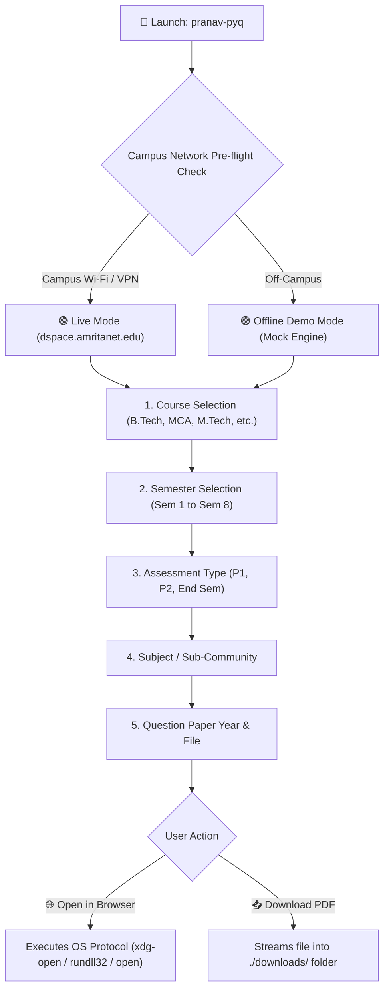

<div align="center">

  

  # ⚡ PRANAV PYQ FETCHER AMRITA ⚡
  
  <p align="center">
    <b>A fast, beautiful, and interactive Terminal Interface (TUI) to browse, search, and download Previous Year Question Papers (PYQs) from Amrita University's digital repository.</b>
  </p>

  <!-- Badges Shelf -->
  <p align="center">
    <a href="https://pkpranav-projects.github.io/PRANAV-PYQ-FETCHER-AMRITA/"></a>
    <a href="https://golang.org"></a>
    
    
    
    
    
    <a href="LICENSE"></a>
  </p>

  <p align="center">
    <a href="#-key-features"><b>Key Features</b></a> •
    <a href="#-campus-network--offline-demo-mode"><b>Network & Offline Mode</b></a> •
    <a href="#-quick-start"><b>Quick Start</b></a> •
    <a href="#-terminal-walkthrough"><b>Walkthrough</b></a> •
    <a href="#%EF%B8%8F-keyboard-shortcuts"><b>Shortcuts</b></a> •
    <a href="#%EF%B8%8F-architecture--how-it-works"><b>Architecture</b></a> •
    <a href="#-tech-stack"><b>Tech Stack</b></a>
  </p>

</div>

---

## 📖 Overview

Amrita Vishwa Vidyapeetham stores its official Previous Year Question Papers (PYQs) within its internal **DSpace Digital Repository** (`dspace.amritanet.edu:8080`). Browsing this archive through a web browser is often slow, requires navigating multiple nested tables, and can be cumbersome right before examinations.

**PRANAV PYQ FETCHER AMRITA** transforms the entire question paper retrieval process into an intuitive, keyboard-driven terminal application. With real-time network checks, fuzzy search filtering, offline exploration, and one-click PDF browser viewing or local downloading, finding exam papers is now instantaneous.

---

## ✨ Key Features

- ⚡ **Automatic Campus Pre-Flight Check**: Pings the Amrita repository on launch to verify campus connectivity before attempting requests.
- 🚀 **Offline Demo Mode**: Stuck at home without campus Wi-Fi or VPN? Launch Demo Mode to explore the full curriculum, test filters, and preview the workflow with simulated courses.
- 🔍 **Instant Fuzzy Search (`/`)**: Simply tap `/` in any menu to type and filter subjects, semesters, or papers on the fly.
- 🌐 **Seamless In-Browser Viewing**: Opens selected PDFs directly in your default web browser (Edge, Chrome, Brave, Firefox) using native OS handlers.
- 📥 **Clean Local Downloads**: Easily save papers to your machine; all downloads are organized automatically into a clean `downloads/` directory.
- ⬅️ **Smart Stack Navigation & Breadcrumbs**: Displays your exact location (e.g. `B.Tech CSE → Semester 4 → Periodical 1 → Operating Systems`) and lets you step back effortlessly without restarting.
- 🎨 **Modern Terminal User Interface**: Styled with Charm's `huh` and `lipgloss` with custom ASCII banners, spinners, and vibrant color-coded states.

---

## 📶 Campus Network & Offline Demo Mode

Because `dspace.amritanet.edu` is hosted on Amrita's private internal intranet, live question paper fetching requires connectivity to the university network:

| Environment | Connection Mode | Status | Capabilities |
|:---|:---|:---:|:---|
| **At University** | Connected to **Amrita Wi-Fi** | 🟢 Live | Direct live fetching, streaming & downloading from university archives. |
| **At Home with VPN** | Connected to **Amrita GlobalProtect VPN** | 🟢 Live | Full access to real-time papers from anywhere in the world. |
| **At Home / Mobile Data** | Off-campus network | 🟣 Demo Mode | **Offline Demo Mode** enabled! Browse sample courses, test filters, and test all app features. |

> 💡 **Notice:** You never have to worry about crashing when opening the tool outside campus. If the intranet is unreachable, the app automatically gives you the choice to enter **Demo Mode** or retry!

---

## 🚀 Quick Start

### ⚡ Method 1: Ready-to-Run Binary (No Setup Needed!)

If you are on Windows, you can launch the app immediately without installing Go:

1. **Double-click:** Run [`run.bat`](run.bat) in the project folder.
2. **Or run via Command Prompt / PowerShell:**
   ```powershell
   .\pranav-pyq.exe
   ```

### 🛠️ Method 2: Run from Source (Developers)

Ensure you have [Golang](https://go.dev/dl/) (1.23+) installed:

```bash
# Clone the repository
git clone https://github.com/pkpranav-projects/PRANAV-PYQ-FETCHER-AMRITA.git

# Enter the directory
cd PRANAV-PYQ-FETCHER-AMRITA

# Run the app
go run main.go
```

### 🏷️ Check Version
```powershell
.\pranav-pyq.exe version
# PRANAV PYQ FETCHER AMRITA v2.0.0
```

---

## 🖥️ Terminal Walkthrough

<div align="center">
  
  <p><i>1. Select Degree / Department</i></p>
</div>

<div align="center">
  
  <p><i>2. Select Semester and Exam Type (Periodical 1, Periodical 2, End Sem)</i></p>
</div>

<div align="center">
  
  <p><i>3. Filter and select the exact Question Paper file</i></p>
</div>

<div align="center">
  
  <p><i>4. Question Paper automatically rendered in your default browser</i></p>
</div>

---

## ⌨️ Keyboard Shortcuts

| Key | Action |
|:---:|:---|
| **`↑` / `k`** | Move cursor up |
| **`↓` / `j`** | Move cursor down |
| **`Enter`** | Confirm selection |
| **`/`** | Activate instant search filter |
| **`Back`** | Return to previous menu level |
| **`Quit`** | Exit cleanly with animated spinner |

---

## 🏗️ Architecture & How It Works



### Scraping Engine
The project uses the Go [`soup`](https://github.com/anaskhan96/soup) package to parse DSpace Manakin (XMLUI) DOM nodes:
1. **Courses**: Scrapes `/xmlui/handle/123456789/16` parsing `<div class="artifact-title">`.
2. **Semesters & Assessments**: Parses `div#aspect_artifactbrowser_CommunityViewer_div_community-view ul li`.
3. **Subjects**: Extracted from `<div xmlns="http://di.tamu.edu/DRI/1.0/">`.
4. **Files**: Queries `<div class="file-list"> <div class="file-wrapper">` to extract direct bitstream links.

---

## 🧰 Tech Stack

- **Core Language:** [Go (Golang)](https://go.dev/)
- **CLI Framework:** [spf13/cobra](https://github.com/spf13/cobra)
- **TUI Controls & Spinners:** [charmbracelet/huh](https://github.com/charmbracelet/huh)
- **Terminal Styling & Themes:** [charmbracelet/lipgloss](https://github.com/charmbracelet/lipgloss)
- **Web Scraping & DOM Parser:** [anaskhan96/soup](https://github.com/anaskhan96/soup)
- **Testing:** Standard Go table-driven parallel unit tests (`go test -v ./...`)

---

## 👨‍💻 Author

**P K Pranav**  
- GitHub: [@pkpranav-projects](https://github.com/pkpranav-projects)  
- Email: [pk.pranav7685@gmail.com](mailto:pk.pranav7685@gmail.com)

*Original base project by Amrita CSE-25 community.*

---

## 📄 License

This project is open-source under the [MIT License](LICENSE).
