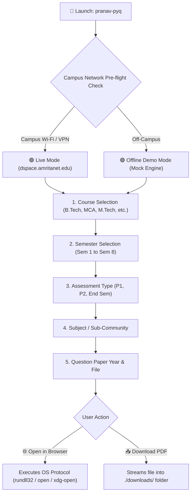

## 🌟 The Ultimate Exam Prep Companion

Navigating university web portals right before exams shouldn't be stressful. **PRANAV PYQ FETCHER AMRITA** turns the slow, multi-click process of navigating the DSpace archive into an intuitive, keyboard-first terminal workflow.

### 📶 Network Connectivity Matrix

Because `dspace.amritanet.edu` is hosted on Amrita's private internal intranet, live fetching requires connectivity to the university network:

| Environment | Connection Mode | Status | Supported Features |
|:---|:---|:---:|:---|
| **At Campus** | Connected to **Amrita Wi-Fi** | 🟢 Live | Direct live fetching, streaming & downloading from university archives. |
| **At Home with VPN** | Connected to **Amrita GlobalProtect VPN** | 🟢 Live | Full access to real-time question papers from anywhere in the world. |
| **At Home / Mobile Data** | Off-campus network | 🟣 Demo Mode | **Offline Demo Mode** enabled! Browse sample courses, test filters, and test all app features. |

---

### 📦 Quick Downloads

Pre-compiled, ready-to-run releases are available for Windows, Linux, and macOS without requiring any Go installation:

- **Windows 64-bit:** [Download ZIP (v2.0.0)](https://github.com/pkpranav-projects/PRANAV-PYQ-FETCHER-AMRITA/releases/download/v2.0.0/pranav-pyq-v2.0.0-windows-amd64.zip) &mdash; *Includes `run.bat` for one-click launch*
- **Linux 64-bit:** [Download TAR.GZ (v2.0.0)](https://github.com/pkpranav-projects/PRANAV-PYQ-FETCHER-AMRITA/releases/download/v2.0.0/pranav-pyq-v2.0.0-linux-amd64.tar.gz)
- **macOS Apple Silicon:** [Download TAR.GZ (v2.0.0)](https://github.com/pkpranav-projects/PRANAV-PYQ-FETCHER-AMRITA/releases/download/v2.0.0/pranav-pyq-v2.0.0-darwin-arm64.tar.gz)
- **macOS Intel:** [Download TAR.GZ (v2.0.0)](https://github.com/pkpranav-projects/PRANAV-PYQ-FETCHER-AMRITA/releases/download/v2.0.0/pranav-pyq-v2.0.0-darwin-amd64.tar.gz)

---

### ⌨️ Navigation Cheatsheet

| Key | Function |
|:---:|:---|
| **`↑` / `k`** | Move cursor up |
| **`↓` / `j`** | Move cursor down |
| **`Enter`** | Confirm selection |
| **`/`** | Activate real-time fuzzy search filter |
| **`Back`** | Return to the previous menu |
| **`Quit`** | Exit cleanly with animated spinner |

---

### 🏗️ How It Works

