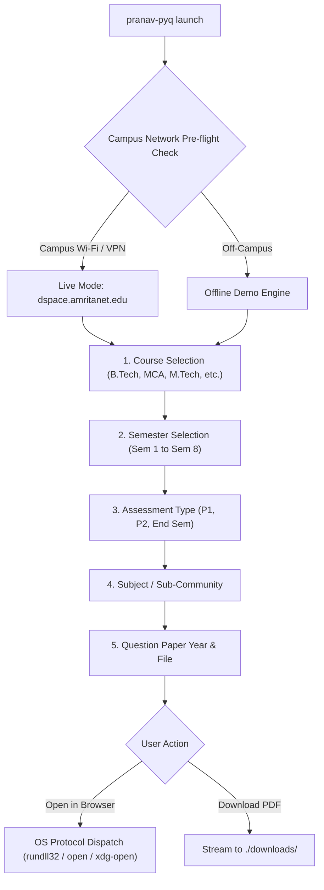

## Core Capabilities

- **Automatic Pre-Flight Network Ping** &mdash; Automatically tests socket connectivity to `dspace.amritanet.edu:8080` on application launch, detecting whether you are on campus Wi-Fi or VPN without any manual configuration.
- **Built-in Offline Demo Mode** &mdash; Browse sample courses, test fuzzy search, and explore simulated question papers offline when off-campus.
- **Instant Search Filter (`/`)** &mdash; Tap `/` in any menu to type and filter subjects, semesters, and question papers in milliseconds.
- **Native Browser PDF Preview** &mdash; Seamlessly launches question paper PDFs inside your default browser (Microsoft Edge, Chrome, Firefox, Brave) for high-fidelity viewing.
- **Organized Local Downloads** &mdash; Automatically creates and routes PDF downloads into a clean, dedicated `downloads/` directory.
- **Interactive Stack Breadcrumbs** &mdash; Keep track of your exact navigation path (e.g. `B.Tech CSE` &rarr; `Sem 4` &rarr; `End Sem`) and step backwards effortlessly.

---

## Terminal-First Architecture

Navigating university web portals right before exams shouldn't be stressful. **PRANAV PYQ FETCHER AMRITA** turns the slow, multi-click process of navigating the DSpace archive into an intuitive, keyboard-first terminal workflow.

### Network Connectivity Matrix

Because `dspace.amritanet.edu` is hosted on Amrita's private internal intranet, live fetching requires connectivity to the university network:

| Environment | Connection Mode | Network Status | Supported Capabilities |
|:---|:---|:---:|:---|
| **At Campus** | Connected to **Amrita Wi-Fi** | ● Connected | Direct live fetching, streaming & downloading from university archives. |
| **At Home with VPN** | Connected to **Amrita GlobalProtect VPN** | ● Connected | Full access to real-time question papers from anywhere in the world. |
| **At Home / Mobile Data** | Off-campus network | ○ Standalone Demo | **Offline Demo Mode** enabled. Browse sample courses, test filters, and explore all app features. |

---

### Binary Releases & Packages

Pre-compiled, ready-to-run releases are available for Windows, Linux, and macOS without requiring any Go installation:

- **Windows 64-bit:** [Download ZIP (v2.0.0)](https://github.com/pkpranav-projects/PRANAV-PYQ-FETCHER-AMRITA/releases/download/v2.0.0/pranav-pyq-v2.0.0-windows-amd64.zip) &mdash; *Includes `run.bat` for one-click launch*
- **Linux 64-bit:** [Download TAR.GZ (v2.0.0)](https://github.com/pkpranav-projects/PRANAV-PYQ-FETCHER-AMRITA/releases/download/v2.0.0/pranav-pyq-v2.0.0-linux-amd64.tar.gz)
- **macOS Apple Silicon:** [Download TAR.GZ (v2.0.0)](https://github.com/pkpranav-projects/PRANAV-PYQ-FETCHER-AMRITA/releases/download/v2.0.0/pranav-pyq-v2.0.0-darwin-arm64.tar.gz)
- **macOS Intel:** [Download TAR.GZ (v2.0.0)](https://github.com/pkpranav-projects/PRANAV-PYQ-FETCHER-AMRITA/releases/download/v2.0.0/pranav-pyq-v2.0.0-darwin-amd64.tar.gz)

---

### Keybindings & Controls

| Key | Function |
|:---:|:---|
| **`↑` / `k`** | Move cursor up |
| **`↓` / `j`** | Move cursor down |
| **`Enter`** | Confirm selection |
| **`/`** | Activate real-time fuzzy search filter |
| **`Back`** | Return to the previous menu |
| **`Quit`** | Exit cleanly with animated spinner |

---

### Execution Lifecycle

